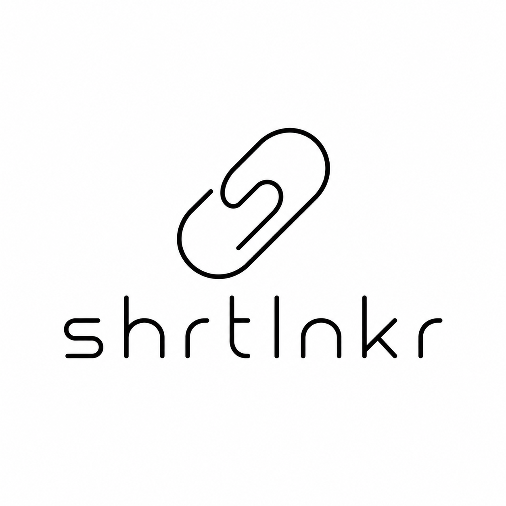

# Short Linker (`shrtlnkr`)

    

**Description** A small Python/Django URL shortener and click tracker. 

**License** Open source on an [MIT license](license.md)

**Base Tech** [Python - Django Framework](https://www.djangoproject.com/) and [PostgreSQL](https://www.postgresql.org/)

**Author** [JohnoTheCoder](https://github.com/johnothecoder) @ [JTC Labs](https://jtclabs.com)

**More Info** [shrtlnkr](https://jtclabs.com/projects/shrtlnkr)

**Installation** [Install Guide](install.md)

---

Create short links through the Django admin, track every redirect, and optionally collect additional client-side metadata (such as browser-provided location) after the redirect.

Originally written to support QR code signup tracking for posters, flyers and printed media.

Temu Bitly for people who know a guy/girl/human/bot who can host a Python project for them.

---

I do not foresee or intend this being widely adopted, if it gets a bunch of stars maybe I'll write some more useful documentation here. 

You're welcome to use it, but you do so at your own risk. This isn't WordPress, Laravel, or Django; I'm just a boy, sitting in front of PyCharm, writing some code, hoping his {Generic Sugar Free Energy Drink} is still cold.

## Why build shrtlnkr?

1. Felt like it
2. Does exactly what I want, how I want, 'cause I wrote it
3. Seemed less effort than the investigative process of finding an alternative
4. Didn't feel like doing `3`, spent 3 minutes, found 47 unmaintained repositories or didn't trust "we compiled it for you... just install it"
5. Python/Django choice, basically `1`... love Laravel, didn't feel like paying for Nova (which is beautiful, tbf), Rails felt a bit much for this one

# V1 Requirements

Managing base requirements here rather than adding the admin burden of managing issues and statuses.

- [x] Add a link with a custom unique `slug`
- [x] Be able to remove/deactivate said link
- [x] User visits `host.tld/c/{slug}` the user is redirected to the relevant destination
- [x] Relevant destination has a unique identifier attached. Default parameter is `clickid`; this is configurable via `.env`
- [x] Redirects are tracked
- [x] Click IDs should be UUID v4
- [ ] `[Optional]` A one-time endpoint is available that allows update of the click record (e.g. if location tracking information is available)
- [ ] `[Optional]` Send a scheduled report of how many clicks there have been (probably weekly)
- [x] Landing page for users hitting the root domain
- [x] Friendly 404 handling
- [ ] Admin Dashboard of some description to give an overview
- [x] Allow Query String Proxy 

# Engineering Notes

- `Query Strings` are proxied to the new redirect HOWEVER they do not support multiple of the same key ?tag=one&tag=two
- IP addresses should be considered advisory analytics only. X-Forwarded-For is only trustworthy when the application is deployed behind trusted reverse proxies configured to overwrite client-supplied forwarding headers.
- `shrtlnk_shortlinkclick` is a count of how many times the controller was hit, a URL was provided, and the record was updated. It is theoretically possible (but unlikely) that the record is created, and updated, but the redirect fails. If no outbound URL is specified in the database, most likely link was found, and the failure or disconnection occurred prior to UPDATE/redirect return
- `ShortLinkClick.save()` is overwritten. Introducing signals and that whole associated ecosystem seemed overkill for something not intended for any kind of high scale environment, engineering-ease and easily-accessible statistics seemed more worthwhile as a "userland code this works readably" than "this will scale by orders of magnitude"